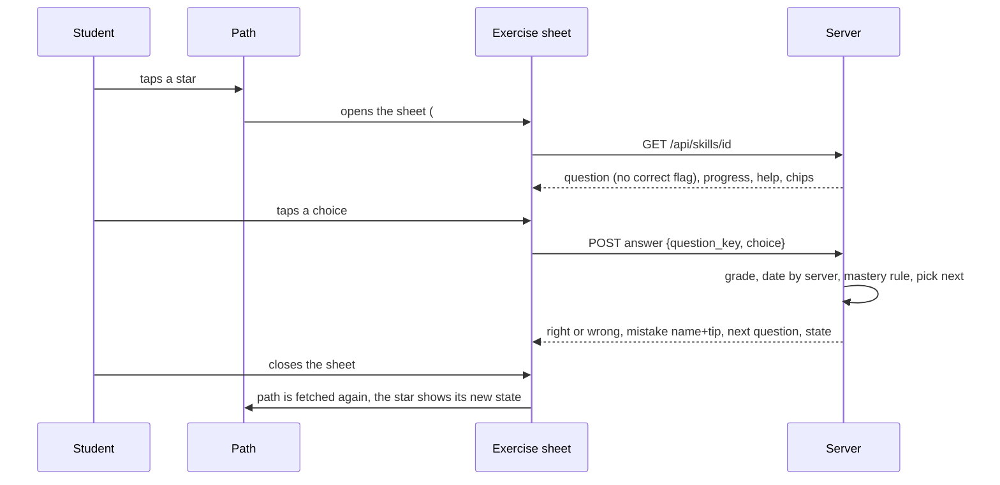

# Design

Target screens, from `docs/mockups/mathly2-screens.html` (sample data):

| Path (light) | Path (dark) | Exercise, wrong answer (light) |
|---|---|---|
|  |  |  |

## Context

See proposal.md for why. After `rebuild-foundation`, `mathly2/` has roles, classes and the sky look, plus student code from an earlier plan that this stage reshapes:

- `learning.py` already holds the rules this stage needs: the mastery rule (3 correct, first try, no help, 2 days), skill states, the next question (least seen, never the one just answered). Their tests already cover every scenario in `skill-mastery`.
- `skills.py` serves a skill in three stages (worked example, faded examples, practice) and has `/stage`. The PRD dropped the first two.
- `static/path.js` is a plain list; `skill.js` is the three-stage screen; `collection.js` and `figures.js` stay.
- mathly1 has the board (`static/math-board.js`, `board-math.js`, `vendor/mathlive/`) and its CSS block inside `static/math.css` (lines 675–824, plus the sheet rules at 62–76).

## Goals / Non-Goals

**Goals:**
- A student can practice a skill on mathly1's exercise screen with instant feedback, and see their progress on the orbit path.
- The board works as in mathly1: beside the exercise on a desktop, full screen on a phone, with its tools and the calculator.

**Non-Goals:**
- The daily goal and streak display, fading stars, the collection, and comets (stage 3, `add-rewards`).
- Quiz nodes on the trail (stage 4). Handing a sketch in (stage 6 uses the board's hand-in; here the board is for working out).
- Writing the solved examples (content work). The help button shows one when the bank has it.

## Decisions

### 1. The solved example is static text, and there is one per skill

The help button shows the skill's explanation and, if the bank has it, a solved example under `worked_example`: `{question, steps: [{do, why}], answer}`, with `why` as plain text (not a choice). `check_bank` validates this shape only. A skill with `faded_examples` is ignored (nothing reads it). The drafting tool writes this shape: one example per skill, no faded ones. *Alternative:* keep the multiple-choice "why this step?" steps. Rejected: the PRD dropped the staged teaching they belonged to.

### 2. The skill API loses its stages

| Route | Now |
|---|---|
| `GET /api/skills/{id}` | the skill, its lesson, state, the question on screen, `solved` of `total` questions, `correct_in_row`, `requires` and `opens` (id and name), and `help` (explanation, solved example if any) |
| `POST /api/skills/{id}/answer` | unchanged rules; a stale question key is refused (409) |
| `POST /api/skills/{id}/help` | unchanged |
| `POST /api/skills/{id}/stage` | **removed** |
| `GET /api/path` | the lessons of the student's classes (all lessons for a teacher or developer), each skill with its state, the `next` skill id (or null), today's goal and the streak |

`solved` counts the distinct questions the student answered correctly (a new store method), so "question n of N" and the dots show progress through the skill. The next skill is `learning.next_skill`: walk the student's recently answered skills, newest first, and take the first that is not mastered; otherwise the first unmastered skill in the bank's order. A new store method `recent_skills(user_id, n)` reads the newest answers, so no migration changes.

### 3. The path: orbits in CSS, drawn from one list

Each lesson is a `section` with a hub and a ring. A star's place comes from its number *i* of *n*: angle = -90° + 360°·*i*/*n*, passed as `--dx` and `--dy`, so the page needs no layout code. The ring's radius is `min(112px, 30cqw)` (the section is a size container), so the six-skill lesson fits a 360px screen. Each star is an `<a href="#/skill/ID">` whose accessible name is its number, the skill's name and its state in words; under it the visible word and symbol. The owl (from `sky.js`) perches on the `next` star; the start marker has the owl, the end marker a spark. Ring arcs between neighbouring stars come from mathly1's `orbitRing`, ported into `sky.js`. The sky colors stay the `--sky-*` tokens from the foundation.

States and looks (spec: Stars show state in words):

| State | Look | Word |
|---|---|---|
| not started | dim outline | ○ לא התחלת |
| learning | half-filled star | ◐ בלמידה |
| mastered | gold star | ✓ נשלטה |
| next (extra) | larger, pulsing, owl | ממשיכים כאן |

### 4. The exercise screen is a dialog over the path

The route `#/skill/<id>` keeps the path drawn and puts a `role="dialog"` sheet on top (`.mx-layer > .mx-scrim + .mx-sheet`, the structure the board expects). Opening from a link or a reload draws the path first, then the sheet. Closing removes the sheet, goes back to `#/`, fetches `/api/path` again and updates the stars without losing the scroll. Choices are shown in a new random order with their bank positions as `data-i`; a tap sends the answer at once. A right answer: a short sparkle and `navigator.vibrate` where the device has it, the count in a row, and a 3-second countdown the student can skip or cancel. A wrong answer is quiet: the mistake's name and tip, a link to the skill to go back to when the bank names one, and a "another question" button; the right choice is never marked. A refused (stale) answer reloads the question that is on screen.

### 5. The board is copied, not rewritten

`math-board.js`, `board-math.js` and `vendor/mathlive/` are copied from mathly1 unchanged. Its CSS block (the board, the toolbar, the calculator, the full-screen mode, the typed-math bar) goes into `static/board.css` together with the sheet, layer and scrim rules the board's layout relies on. The block uses mathly1's variable names (`--ink`, `--mx-accent`, `--sumac`, ...); a small block at the top of `board.css` defines each from the sky tokens, so the board follows the sky with no edits to its rules. The sheet calls `MathlyBoard.mount(layer, "<skill>:<question_key>", {question: () => questionElement})` every time a question is shown, so each question keeps its own sketch; the header carries `MathlyBoard.button()`, and a click on `[data-board-toggle]` calls `MathlyBoard.toggle()`. On a phone this opens the board full screen; on a desktop (`min-width:1000px` and a fine pointer) it sits beside the sheet. Hand-in (`submit`) is left unset in this stage.

### 6. Removing the old stages

`skill.js` is replaced by `exercise.js` (the sheet); the worked and faded screens, the `/stage` route, the stage logic in `skills.py`, the faded checks in `bank.py`, the faded part of the drafting tool, the old skill-screen CSS and the progress table's two stage columns are deleted, together with the tests that only covered them.

## Risks / Trade-offs

- [The board's CSS and JS are large (65 KB and 1.2 MB of MathLive) and came from a different theme] -> They load only when the board is first opened (`board.css` and the scripts are added then); a Playwright test opens it on a phone and on a desktop width.
- [The orbit looks wrong with 2 or 6 skills] -> A browser test draws the lessons with 2, 3 and 6 skills at 360px and checks that no star leaves the screen or overlaps the hub.
- [Copying board.css selectors from mathly1 could clash with the sky CSS] -> `board.css` is scoped to `.mx-*` classes, which nothing in mathly2 uses; the `.row`, `.tag` and `.card` classes are not touched.
- [Pen, palm and calculator behaviour cannot be fully tested in a headless browser] -> The tests cover tools, drawing, undo, the calculator's result and the layout; palm rejection and pen pressure are left to a manual check on a tablet.

## Migration Plan

One small migration, `20261108090000_m2_progress_without_stages.sql`: it drops the two columns of `m2_skill_progress` that remembered a skill's stage (`stage`, `faded_done`), which nothing reads any more. Only an `m2_` table changes; the answers table is untouched. It must run after the three earlier migrations. Removing the `/stage` route and the faded checks is the only other breaking change, and nothing outside `mathly2/` uses them. Rollback: the migration's header lists the statements that add the columns back; the code is in git.
