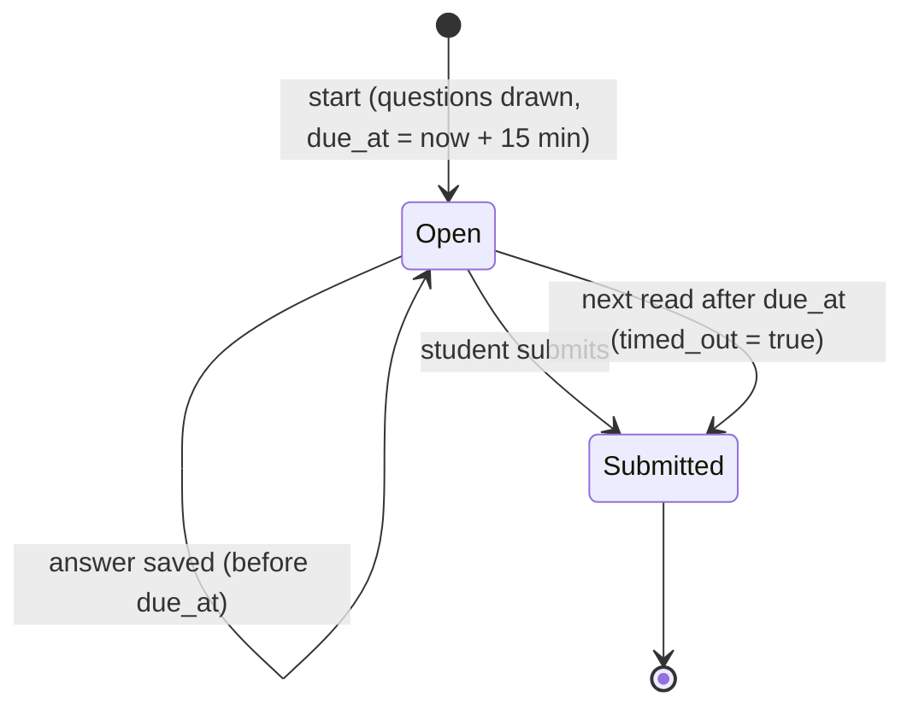

# Design

## Context

See proposal.md for why. After `add-rewards`, `mathly2/` has what a quiz needs and lacks what makes it timed and graded:

- **Reusable:** `bank.practice_question` serves a question with no `correct` flag; `bank.grade` grades one choice by its bank position and names the mistake (`name`, `tip`, `back`); `clock.now()` is the one source of time; the exercise sheet (`exercise.js`) already mounts the smart board per question and the board's calculator; `GET /api/path` lists each lesson with its skills.
- **Missing:** any stored attempt, a server deadline, a grade, and a screen for either. Nothing in `mathly2` is timed yet, and stage 5 (`add-test-readiness`) needs the same machinery for exercise tests and the simulation, so the engine is built once here and kept generic.
- **The bank:** 95 of 96 skills have questions (90 have 10, five have 30); the skill `a_30_side` (lesson `l`) has none, so a quiz can never assume a question for every skill. Each lesson has 2–6 skills. Every lesson also carries an authored written `quiz` (minutes, questions), which this change ignores (spec: Written quizzes are not lesson quizzes).

## Goals / Non-Goals

**Goals:**
- A quiz per lesson with a server timer, answers saved as they are given, a grade on the 0–100 scale, and a result that never shows right answers.
- One attempt engine (`attempts.py`) that the exercise test and simulation can use without a new table.
- A trail node per lesson and a grades screen.

**Non-Goals:**
- Exercise tests, the simulation, the test countdown and the readiness meter (stage 5), and assignment grades (stage 6): the grades screen lists only quiz grades now and takes the others as they arrive.
- Teacher views of quiz grades (stage 8).
- Pen or photo answers: a quiz is multiple choice only.

## Decisions

### 1. One generic attempts table

| Table | Columns | Meaning |
|---|---|---|
| `m2_attempts` | `id` uuid, `user_id`, `kind` (`quiz` now; `exercise_test`, `simulation` later), `scope` (the lesson id for a quiz), `started_at`, `due_at`, `submitted_at` null, `timed_out` bool, `grade` int null (0–100), `questions` jsonb `[{skill_id, key}]` in order, `answers` jsonb `{ "<question key>": choice }` (a question key already starts with its skill id) | one timed, graded try |

A row with `submitted_at` null is open. Questions are stored as references into the bank (never the questions themselves), so a bank edit cannot change an old attempt's grade as long as the question keys exist; the grade is stored, not recomputed. `answers` is rewritten with each saved answer. Row security as the other `m2_` tables (server key only). A migration `20261110090000_m2_attempts.sql` adds the table; nothing else changes. *Alternative:* a `m2_quiz_attempts` table plus an `m2_answers`-style row per answer. Rejected: three more tables for data that is always read and written as one attempt, and stage 5 would need copies.

### 2. The server finishes an attempt when time is up, on the next read

There is no background job. Every read or write of an attempt first runs `attempts.settle(row, now)`: if `now >= due_at` and the attempt is open, it is graded from the answers saved so far, `timed_out` is set, and it is stored. So a student who closes the app and returns 20 minutes later reads a submitted attempt with the answers they had given (spec: When time ends), and the grades screen settles any overdue attempt the same way before it lists. An answer that arrives after `due_at` is refused with 409 and the attempt is settled. A manual submit before the deadline grades at once. Both paths use one function, so they cannot disagree. *Alternative:* a scheduler that submits at the deadline. Rejected: a thing to run and keep alive, and reads must be right even if it were late.

### 3. Starting resumes an open attempt, otherwise draws a new quiz

`POST /api/lessons/{id}/quiz/start` returns the student's open attempt for that lesson if there is one that has not timed out; otherwise it draws and stores a new one. So a refresh, a second tab or a lost connection continues the same attempt instead of burning a try. The timer is the stored `due_at`: the response carries `due_at` and the server's `now`, and the screen counts down from their difference, so a wrong device clock changes nothing.

### 4. How a quiz is drawn

`quiz.draw(bank, lesson_id, used, rng)` where `used` is how often the student had each question in earlier attempts of this lesson:

1. Skills without questions are left out (today only `a_30_side`; the spec's "one per skill" then applies to the skills that have questions).
2. Each skill gets `10 // k` questions and the remaining `10 % k` go to distinct skills chosen at random, so quotas differ by at most one (4 skills: 3,3,2,2; 6 skills: 2,2,2,2,1,1).
3. Within a skill, questions are taken least-used first, ties in random order; so a retake takes new questions while the skill has enough unused ones (10 per skill, quota at most 5: the first two attempts are always completely new for a quota up to 5), and repeats the least-used after that.
4. The final order of the 10 is shuffled; the order of choices is shuffled on the screen by the existing `shuffled` helper, with bank positions kept as `index`.

`rng` is a parameter so tests are exact. *Alternative:* pick 10 at random from the whole pool. Rejected: it can leave a skill out entirely, which breaks "at least one per skill".

### 5. Grading and what is revealed

`attempts.grade(bank, questions, answers)` counts right answers with `bank.grade` (a missing answer is wrong) and returns `(100·right/n)` rounded half up (`(200·right + n) // (2n)`: 7/10 → 70, 8/12 → 67). The result adds, for each wrong or missing question: the skill (id, name, a link), the question text, the choice the student picked, and the mistake's `name` and `tip` (none for a missing answer). It never carries a `correct` flag, the right choice's text or its position, and `GET /api/attempts/{id}` of an **open** attempt serves questions through `practice_question` only. A submitted attempt can be read again later; each read gives the same result.

### 6. Routes

| Route | Does |
|---|---|
| `GET /api/lessons/{id}/quiz` | the quiz node's facts: `best` grade or null, `attempts` count, whether an attempt is `open` |
| `POST /api/lessons/{id}/quiz/start` | decision 3; refused (404) for a lesson the student does not have |
| `GET /api/attempts/{id}` | the open attempt (questions, saved answers, `due_at`, `now`) or the result |
| `PUT /api/attempts/{id}/answers` | `{skill_id, key, choice}` saved; 409 when the attempt is over |
| `POST /api/attempts/{id}/submit` | grade now (idempotent: a submitted attempt returns its result) |
| `GET /api/grades` | every lesson with a quiz grade: lesson, best grade, attempts, last taken |

`GET /api/path` adds to each lesson `quiz: {best, open}`. Only the attempt's owner can read it (404 for anyone else). All use the `path.use` permission, as the rest of the student's routes, and the permission matrix test is extended.

### 7. The quiz screen: a sheet like the exercise screen, with a timer and no feedback

`#/quiz/<lessonId>` draws the path under a sheet (the same `.mx-layer` structure, so the board mounts as in the exercise screen, with the calculator, one sketch per question). The sheet shows "שאלה n מתוך 10" with dots for answered questions, the countdown (text, updated each second, with `aria-live` only at 5, 1 minute and the end, so it does not chatter), the question with its shuffled choices, previous/next, and "הגשה". A choice is saved on tap (`PUT answers`) and can be changed until submitting; nothing says whether it is right. "הגשה" asks once ("יש N שאלות בלי תשובה") then submits. At zero the screen asks the server for the attempt, which settles it, and shows the result. Skill names are not on the question; the lesson's name is. The result shows the grade as a big number, "הציון של השיעור: best", the skills that lost points each linking to `#/skill/<id>`, and the missed questions with the mistake's name and tip, and a "בוחן חוזר" button. Closing the sheet leaves an open attempt open, and the node says "בוחן פתוח, נשארו mm:ss".

### 8. The trail node and the grades screen

After a lesson's ring the trail gets a node (an `<a href="#/quiz/<id>">`) in the style of the stars: a dashed hub with "בוחן" and its state in words: "○ עוד לא נעשה", "✓ הציון: 85" or "◐ בוחן פתוח". It is always open. The student's tabs become path, grades (`#/grades`) and collection. The grades screen lists lessons with a quiz grade (name, best grade as a number and a bar, attempts, date), best first within the order of the path, and says "עוד אין ציונים" when empty. Later stages add their rows to the same list.

## Risks / Trade-offs

- [A student gets the same questions on the 3rd retake] -> Least-used-first makes repeats the exception; the spec only promises new questions "as long as the lesson has enough unused ones", and a test pins both sides of that.
- [Answers saved one by one make many small requests] -> At most 10 writes per quiz, each a single-row update; acceptable.
- [Clock tricks on the device] -> The deadline is the server's `due_at`; the countdown is cosmetic and the server refuses late answers.
- [Open attempts pile up if students never come back] -> They are settled on the next read, so they become submitted attempts with whatever was answered; a quiz abandoned empty becomes a 0 attempt but never lowers the best grade.
- [A bank edit removes a question an old attempt used] -> The stored grade stays; re-reading a result skips a question the bank no longer has instead of failing.

## Migration Plan

Run `20261110090000_m2_attempts.sql` after the five earlier migrations. It only adds one table, so it is safe to run before the code, and rollback is `drop table m2_attempts` (in the file header). Existing students have no attempts, so every quiz node starts at "עוד לא נעשה".
