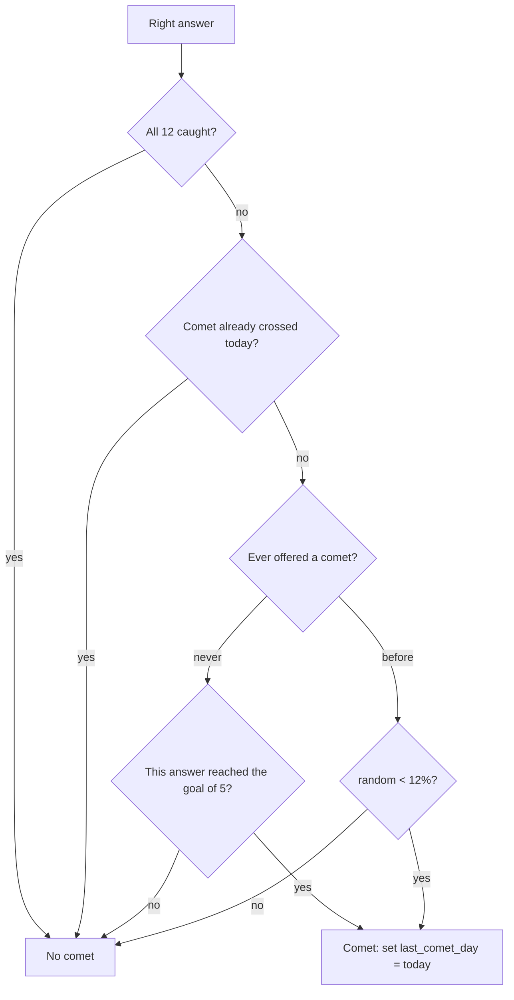

# Design

## Context

See proposal.md for why. After `add-learning-core`, `mathly2/` already has more of this stage than the proposal assumes:

- **Daily goal and streak are built and tested.** `learning.today_progress` and `learning.streak` count the student's correct answers per Israel calendar day (`store.daily_correct`, helped answers included), `GET /api/path` returns `today` and `streak`, and `ui.goalBar` draws them at the top of the path. This stage adds no code for them, only the scenario tests of `rewards` that are missing (see tasks 1.1).
- **A plain collection exists** (`GET /api/collection`, `collection.js`): two lists, mastered skills and completed lessons, with no drawings.
- **Fading and comets do not exist.** The answers table already holds every answer with its server-set day, so fading needs no new data; comets need a small amount of per-student state.
- mathly1 has the rules and drawings in `static/math-sky.js`: `COMETS` (12, with symbol, name, fact), `cometDue`, `catchComet`, `SHAPES`/`shape()` (a constellation per unit) and `comet()`/`cometCard()` drawings. mathly1 keeps this state in the browser (`P.comets`, `P.cometDay`); mathly2 must keep it on the server like everything else (PRD MST-5).

## Goals / Non-Goals

**Goals:**
- Faded stars on the path and in the collection, decided by the server from answer dates.
- The collection as mathly1 draws it: a star per mastered skill, a constellation per completed lesson, the twelve comets.
- Comets that cross after a right answer, are caught by tapping, and are remembered per student; the server decides when one is due and which one is caught.

**Non-Goals:**
- Sounds, vibration patterns and the celebration overlays of mathly1 beyond what the exercise screen already does.
- A teacher's or the readiness meter's view of fading. Fading never leaves the student's own screens (spec: Fading stars).
- Any change to mastery, grades or the streak.

## Decisions

### 1. The server decides fading and sends a flag

`GET /api/path` and `GET /api/collection` add `faded: true` to a mastered skill whose newest answer is 14 or more school days old; every other skill has `faded: false`. A new store method `last_answered(user_id)` returns `{skill_id: date}` from the answers table (one query, newest per skill), in both stores. The state itself stays `mastered`, so every consumer of state (readiness, heat map, exercise tests) is unchanged and cannot be affected by fading. The client shows a dimmed star and the word "דועך" under it, plus the symbol "◌" so it is not by color alone. An answer on the skill, right or wrong, writes a row dated today, so the next read relights it with no extra code. *Alternative:* store a `faded` column and update it with a job. Rejected: derived data that can go stale, and a job to run.

### 2. Comet state is two small `m2_` tables

| Table | Columns | Meaning |
|---|---|---|
| `m2_comets` | `user_id`, `comet_id`, `caught_at`; primary key (`user_id`, `comet_id`) | the comets a student caught |
| `m2_reward_state` | `user_id` primary key, `last_comet_day` date, `last_catch_day` date | the day a comet last crossed, and the day one was last caught |

The twelve comets (id, symbol, name, fact) live in a Python module `comets.py` and are served by `GET /api/comets` together with which ones the student has; the client does not carry its own copy. Row security follows the other `m2_` tables (the server's key only). A new migration `20261109090000_m2_rewards.sql` creates both and is the only database change.

### 3. When a comet is due: the answer response says so

The answer route (`POST /api/skills/{id}/answer`) already knows the day's count. After a **right** answer it calls `comets.due(state, caught, today, goal_just_reached, rng)`:

"Ever offered" is `last_comet_day is not null`. So the first comet is certain on the first goal-reaching answer and never before; after any offer, 12% a right answer. The response gets `comet: true` only when due; the day is stored at that moment, so a reload cannot give a second comet. `rng` is a parameter so tests pass a fixed value. *Alternative:* roll the chance in the browser, as mathly1 does. Rejected: the device would decide, which the PRD forbids for anything that is stored (a student could farm comets with dev tools).

### 4. Catching: one catch per offered comet, picked by the server

`POST /api/comets/catch` accepts only when `last_comet_day` is today and `last_catch_day` is not today; it picks a random comet the student does not have, writes the row and `last_catch_day`, and returns the comet (symbol, name, fact). Otherwise it answers 409 ("אין שביט לתפוס"). Tapping a comet twice, or a second tab, therefore catches at most one. When all twelve are held, none is ever offered (decision 3), so the route cannot be reached in that state.

### 5. The comet on screen is drawn by the exercise screen

After a right answer with `comet: true`, `exercise.js` draws a comet that crosses the sheet in about 4 seconds (CSS animation on `transform`, ported from `Sky.comet`). Under reduced motion it draws no moving comet: a still "☄ שביט!" button appears once, below the feedback, and disappears when the next question loads. A tap calls the catch route and shows the comet card (symbol, name, fact) in a small dialog the student closes with a button or Escape. The comet never blocks answering: it is `position:absolute` over the sheet with `pointer-events` only on the comet itself.

### 6. The collection draws constellations

`collection.js` is rewritten as three parts: the lessons completed as constellations, the mastered skills as stars, and the twelve comets. A constellation is an inline SVG drawn by `sky.js` from a port of mathly1's `SHAPES` and `shape()`: the lesson's id picks a shape (a fallback zig-zag when none is defined), and the lesson's skills sit on it in order, as small gold stars with the skill's number. A mastered skill in the stars list is a link to it, faded ones dimmed with "דועך". Each comet is a button: caught ones show symbol and name and open a card with the fact; missing ones show "?" with "עוד לא נתפס" and open nothing but a one-line hint. `GET /api/collection` adds `faded` per skill and the comets list moves to `GET /api/comets`.

### 7. No other state changes

Nothing is stored for fading, and no existing table changes. The path's daily goal and streak stay as they are.

## Risks / Trade-offs

- [The drawing of 20+ shapes is a lot of ported code] -> Port `SHAPES`, `shape()` and `along`/`onCorners` as they are, and test two lessons of different sizes plus the fallback in a browser; only the labels logic of mathly1 is left behind (the collection needs numbers, not names beside the stars).
- [A 12% random chance is hard to test] -> `rng` is injected; unit tests cover 0.11 and 0.13, the browser test uses a server started with a fixed value.
- [Reduced motion changes the flow, and a still button can be missed] -> It stays under the feedback until the next question; the test checks it appears once and that the comet is not animated.
- [The first comet on the first goal day needs five right answers in one session] -> That is the PRD's rule ("the reward arrives early"); the test drives five answers through the API.
- [Fading dims a star the student may never need again] -> Only a cue, and the word says "דועך", not "forgotten"; the spec forbids it from reaching any grade.

## Migration Plan

Run `20261109090000_m2_rewards.sql` after the four earlier migrations. It only creates two new `m2_` tables, so nothing breaks if it runs before the code, and rolling back is `drop table m2_comets, m2_reward_state` (listed in the file header). Existing students simply start with no comets and no `last_comet_day`, so their first goal-reaching answer after the deploy brings the first comet.
