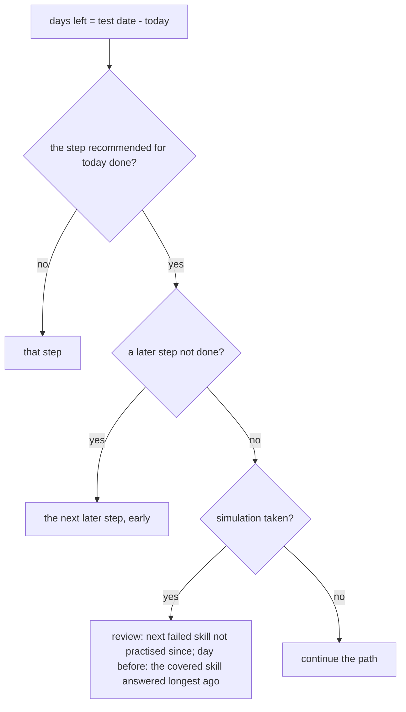

# Design

## Context

See proposal.md for why. What `mathly2/` gives this stage after `add-lesson-quizzes`:

- **The attempt engine** (`attempts.py`, table `m2_attempts`): a timed try with a server deadline, saved answers, settle-on-read, the 0–100 grade and a result that never reveals right answers. `kind` already allows `exercise_test` and `simulation`, and `scope` is free text. So exercise tests and the simulation need **no change to attempts**, only a draw and their own routes and screens.
- **The quiz sheet** (`quiz.js`): countdown from the server's `due_at`, question dots, saved choices, board and calculator, submit with a warning, the result. It is written for a lesson's quiz; this stage generalises its titles and routes so the same sheet runs all three kinds.
- **Skill states** (`learning.skill_state`, `store.progress_of`), classes with their lessons and teacher (`m2_classes`), the teacher's home (`teacher.js`, `GET /api/teaching`), and the grades screen (quizzes only so far).
- **Student screens:** the subject card opens the path; the tabs (path, grades, collection) sit at the top of the page. The user decided (2026-11-08) that the card opens the subject's **home**, as in mathly1, with the tab bar at the bottom (the `learning-path` delta in this change).

## Goals / Non-Goals

**Goals:**
- A teacher sets a real test; every student of the class gets a countdown, two exercise tests and a simulation from it, without anything being created per student in advance.
- The readiness number and today's task are computed by pure functions, tested on their own, and served by the server.
- One quiz sheet for quizzes, exercise tests and the simulation.

**Non-Goals:**
- A teacher sending an exercise test as an assignment (EXT-2): it needs assignments (stage 6).
- The rest of the home: assignments, AI requests, photo help (stages 6 and 7). Home is built so they can be added as cards.
- Notifications about the test (stage 7, push).
- Teacher views beyond the tests tab (heat map, coverage: stage 8).

## Decisions

### 1. One new table; everything else is derived

| Table | Columns |
|---|---|
| `m2_tests` | `id` bigint, `class_id` → `m2_classes`, `date` (the test day, Israel calendar), `lessons` text[], `note` text, `questions` int default 12 (1–40), `minutes` int default 45 (5–180), `created_by`, `created_at`, `removed_at` null |

The two exercise tests and the simulation are not rows: they exist because the test exists. Their attempts go into `m2_attempts` with `kind = exercise_test` and `scope = "<test id>:1"` or `":2"`, and `kind = simulation` with `scope = "<test id>"`. So "the app creates 2 exercise tests for every student" (EXT-1) holds for students added later too, and moving the date moves everyone's countdown with no update (spec: Moving the date). Removing a test sets `removed_at` (soft delete), so the grades already earned keep their test's name on the grades screen. The migration is `20261111090000_m2_tests.sql`. *Alternative:* a row per student per exercise test. Rejected: it must be kept in step with the roster and the date, for no information that cannot be derived.

### 2. The countdown is a pure function of days left

`countdown.plan(days_total)` gives each step a recommended day; `countdown.today(test, facts, today)` gives the one task for today. The steps and their days for a test set 9 or more days ahead are the PRD's: path until 9, exercise test 1 at 9, exercise test 2 at 7, simulation window from 5, review 4 → 1 (the last day "light mixed review"). For a test set `n < 9` days ahead every day `d` of the plan becomes `round(d · n / 9)`, keeping the order (6 days: exercise test 1 at 6, exercise test 2 at 5, simulation from 3, review 3 → 1; days are rounded half up); `n` is the days between the day the test was set and the test day, so the plan does not shift as days pass.

Today's task, from the closest test (spec: Several tests):

A step is **done** when: path, every covered skill is mastered; an exercise test, it has a submitted attempt; simulation, it was taken. During "until 9" the task is "finish the path" and opens the next unmastered covered skill. The days are recommendations only: every step can be opened at any time (except the simulation's window, decision 4).

### 3. Exercise test questions

`exam.draw_exercise(bank, lessons, states, weak_from_tests, n, share, used, rng)`, with `share` 0.6 for test 1 and 0.3 for test 2:

1. Covered skills = the skills of the test's lessons that have questions. **Not started** ones are left out and returned as `practice_first` (shown on the test's card).
2. **Weak** = covered skills in the learning state, plus any covered skill answered wrong in an earlier exercise test of this real test. **Other** = the remaining started covered skills.
3. `w = round(n · share)`. Weak questions: **one per weak skill**, the weak skills in random order, up to `w` (so 3 weak skills give 3, as in the spec's scenario). The rest, `n − weak taken`, comes from the other skills, one per skill round after round, then from weak skills again if the others run out. Within a skill the least-used question first (`used` counts this student's earlier exercise-test and simulation attempts of this real test), as in the quiz draw.
4. If no covered skill is started there are no questions: the test cannot start and its card says "practice these first".

The simulation uses the same draw with no weak share (`share = 0`): an even spread over all started covered skills, one per skill round after round; not-started skills are still left out (they are the student's own gap, and the simulation reports them as not ready). *Alternative:* allow several questions per weak skill to reach 60%. Rejected: a mixed test should touch many skills, and the spec's scenario counts one per skill.

### 4. The simulation's window and its one attempt

Open when `days_left ≤ window` (5, or `round(5 · n / 9)` for a short-notice test) and `days_left ≥ 0`, so it stays open through the test day. Before that `POST .../simulation/start` answers 409 with the opening date, and the screen says when it opens. One attempt: the start route returns the existing attempt (open or submitted) if there is one and never draws a second. The failed skills of a submitted simulation (skills with at least one missed question) are the review list (spec: Review tasks).

### 5. Readiness

`readiness.compute(M, E, S)` in one pure function: `M` = mastered covered skills ÷ covered skills (skills with questions), as 0–100; `E` = the average of the best grade of each exercise test taken (one or two); `S` = the simulation grade. The number is `Σ(weight·part)/Σ(weight)` over the parts that exist (M 50, E 20, S 30), rounded half up; without `S` it is capped at 80 and the response says `capped: true`. Labels: 0–39 "מתחילים", 40–69 "בדרך", 70–84 "כמעט שם", 85–100 "מוכנים" (only reachable with S). Unit tests pin the spec's numbers: 60 → 60; 80, 70, 90 → 81; 100, 95, none → 80 capped.

### 6. Routes

| Route | Who | Does |
|---|---|---|
| `GET /api/teaching/tests` | teacher of the class (`class.teach`) | the teacher's classes' tests, each with its students: simulation taken or not, readiness |
| `POST /api/classes/{id}/tests` | teacher of that class | set a test (date not in the past, lessons ⊆ the class's lessons, defaults 12/45) |
| `PUT /api/tests/{id}` / `DELETE /api/tests/{id}` | teacher of its class | change before its date / remove (soft) |
| `GET /api/home` | `path.use` | the student's upcoming tests (closest first) with days left, readiness, today's task, the simulation's state, and the path's next skill |
| `GET /api/tests/{id}` | a student of the class | the test's card: plan, readiness, both exercise tests (best grade, practise first), the simulation (window, taken, review list) |
| `POST /api/tests/{id}/exercise/{1\|2}/start`, `POST /api/tests/{id}/simulation/start` | a student of the class | start or resume, as the quiz start; attempts are then read, answered and submitted through the existing `/api/attempts/{id}` routes |

`_mine` in `quizzes.py` accepts the three kinds; the result of an exercise test or simulation links weak skills exactly as a quiz result does. `GET /api/grades` adds exercise tests (best per test and number) and simulations, by test, after the quizzes. The permission matrix test lists every new route; a teacher of another class gets 404 for a test that is not theirs.

### 7. Screens

- **Tab bar at the bottom** (`ui.tabs`): בית, מסלול, ציונים, האוסף, fixed to the bottom with the safe-area inset, each at least 44px; the page gets bottom padding so nothing hides under it. The card opens `#/subject/math` = home; the path moves to `#/subject/math/path`. Old links to `#/subject/math` therefore land on home, which is what the card now does.
- **Home** (`home.js`): for the closest test, a card with its name (the lessons), "בעוד N ימים", the readiness bar with M, E, S under it and the cap note, and **one big button** for today's task; a "חובה" card for an open, untaken simulation; "להמשיך במסלול" (opens the next skill); other upcoming tests as small rows. With no test: only the continue button and a line that the teacher has not set a test.
- **A test's card** (`#/test/<id>`): the plan as a list of steps with their recommended days and done marks, the two exercise tests with best grade and "התחלה" / "שוב", "practise these first" with links, the simulation (opens on…, required, taken with its grade and review list).
- **The sheet**: `quiz.js` takes the kind from the attempt and changes only its title ("בוחן", "מבחן תרגול 1", "מבחן סימולציה") and, for the simulation, removes "בוחן חוזר" and says it can be taken once. Addresses: `#/exam/<test>/<1|2>[/<attempt>]`, `#/sim/<test>[/<attempt>]`.
- **Teacher's tests tab** (`#/tests` in `teacher.js`, a second tab beside the classes): per class, "קביעת מבחן" (date, lesson checkboxes from the class's lessons, note, questions, minutes with the defaults filled), and each test with edit/remove, "N מתוך M עשו סימולציה", the names of those who have not, and each student's readiness.

## Risks / Trade-offs

- [Rounding the plan for very short notice makes steps share a day (2 days: everything on days 2 and 1)] → The order is kept and every step stays startable; a test for 2 days with 4 steps cannot be spread further.
- [A student with almost nothing started gets a tiny or empty exercise test] → The card says what to practise first; the test is shorter rather than padded with not-started skills, which the spec forbids.
- [Readiness and the plan on every home load cost several store reads] → One `progress_of`, one `attempts_of` per kind, and the class's tests per request; fine at class size, and the functions are pure, so caching can be added later.
- [Moving the tabs to the bottom changes every student screen's tests] → The tab bar is one helper; browser tests find tabs by their link, not by position.
- [The teacher sees each student's readiness, which some students may not like] → It is the PRD's rule (RDY-1); only the class's own teacher sees it.

## Migration Plan

Run `20261111090000_m2_tests.sql` after the six earlier migrations; it only adds `m2_tests`. No existing table changes (`m2_attempts.kind` already allows the new kinds). Rollback: `drop table m2_tests` (in the file header); attempts of removed tests stay as harmless rows. Students see no test until a teacher sets one.
