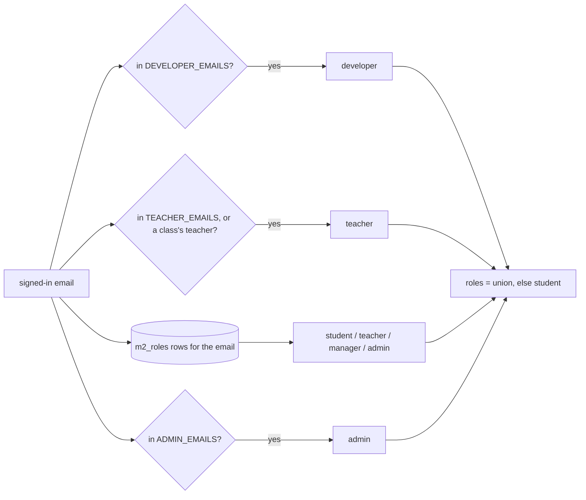
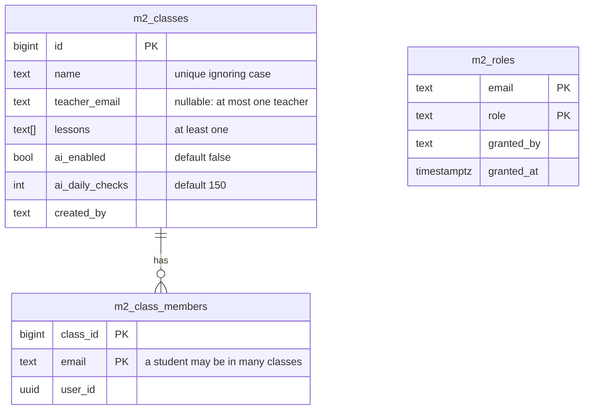

# Design

Screens: `docs/mockups/mathly2-screens.html` (student, teacher and manager tabs). The screenshots below are taken from that mockup (sample data); the admin's accounts screen is not drawn yet.

## Screens in this stage

| Sign-in (light) | Sign-in (dark) |
|---|---|
|  |  |

Spec: Google sign-in. mathly1's page: logo, owl, one status line, one Google button.

**Manager: class list** (spec: Class and student lists)

**Manager: class editor** (spec: Manager creates classes; Editing and deleting a class). The AI switch starts off.

**Manager: students list**, with a student in two classes

**Teacher home: my classes and their rosters** (spec: Teacher home; Teacher adds students by email)

On a phone: [teacher-classes-phone.png](./screenshots/teacher-classes-phone.png)

## Context

See proposal.md for why. Today `mathly2/` has: Google sign-in through Supabase plus a dev sign-in (`auth.py`); two roles, teacher from `TEACHER_EMAILS`, everyone else a student (`auth.current_user`); classes created by a teacher (`classes.py`); the tables `m2_classes` (with `teacher_email` = the creator) and `m2_class_members` (email is the primary key, so a student can be in one class only); a light/dark CSS with a plain accent (`static/app.css`); and the student practice code from the retired `build-skill-learning` change, which stage 2 reshapes.

The migrations have never been applied to the real Supabase project, so the `m2_` tables can still change shape through a new migration.

## Goals / Non-Goals

**Goals:**
- One place decides roles and permissions, used by every route, so later stages only declare what a route needs.
- Classes and roles that match the PRD before any learning feature depends on them.
- The sky look as app-wide tokens, so every later screen inherits it.

**Non-Goals:**
- The path, exercise screen and board (stage 2). The current student screens stay as they are until then.
- Using the AI switch and budget: this stage stores them; stage 7 uses them.

## Decisions

### 1. Roles: settings, a roles table and class teachers, merged on every request

- A new table `m2_roles (email, role, granted_by, granted_at)`, with the key (email, role) and the role one of student, teacher, manager, admin. Roles are keyed by **email**, so they work before the first sign-in (spec: Admin gives roles).
- The developer role exists only in settings, so the roles table can never create one.
- Roles are resolved on every request. A 30-second cache per email keeps it to one store call per page load; a role change shows within 30 seconds. *Alternative:* roles in the sign-in token. Rejected: a removed role would live until the token expires.

### 2. Permissions are named, and routes ask for a permission, not a role

`access.py` holds the matrix (as mathly1's `app/access.py` does): `path.use`, `class.view` (a class one teaches), `class.roster`, `classes.manage`, `roles.manage`, `*` for developers. A route declares `Depends(need("classes.manage"))`; class-scoped routes also check that the class is one the caller teaches. One test reads every route from the app and checks each refuses the roles it must refuse.

### 3. Class tables reshaped with one new migration

- `m2_class_members` gets the key (class_id, email) instead of email alone; `m2_classes.name` becomes unique ignoring case across all classes, as in mathly1. `teacher_email` keeps its column but now means "the class's teacher" and may be empty.
- A check refuses a class whose teacher is also one of its students.
- *Alternative:* edit the old migration file. Rejected: a migration that already ran anywhere must not change; a new one is safe on any database.

### 4. API

| Route | Who | Does |
|---|---|---|
| `GET /api/me` | anyone signed in | email, roles, permissions, classes as student, classes as teacher |
| `GET/POST/PUT/DELETE /api/classes[/{id}]` | manager, developer | list, create, edit, delete classes |
| `POST/DELETE /api/classes/{id}/students` | the class's teacher, manager | add pasted emails, remove one |
| `GET /api/students` | manager | every student with their classes |
| `GET /api/teaching` | teacher | the classes I teach, with students |
| `GET /api/accounts`, `POST/DELETE /api/accounts/{email}/roles/{role}` | admin | known accounts, give, take away |

Taking away the last admin role is checked in one store call that counts admins and deletes together, so two admins removing each other at once cannot leave none.

### 5. Screens: a role switcher in the header

A person with several roles sees a row of role chips in the header (תלמיד, מורה, מנהל כיתות, מנהל הרשאות, מפתח), each opening that role's home; the device remembers the last one. Homes: student (the current screens), teacher (classes and rosters), manager (classes, editor, students), admin (accounts and roles). The sign-in page is mathly1's: logo, owl, status line, one pill button.

### 6. The sky look as global tokens

`app.css` defines `--sky-*` tokens on `:root`, in one dark set (night blue, aurora, starlight, gold), plus the owl as an inline SVG. Reduced motion turns every animation off in one rule. Later stages use only these tokens. The `body` background is the sky itself: two soft radial glows as in mathly1 (blue and purple, strength `--sky-glow`) and eight tiny stars drawn in `--sky-star`, all fixed to the viewport. There is no light set, as in mathly1. It is static, so it needs no reduced-motion rule.

### 7. Settings come from three places, in a fixed order

Real environment variables, then `mathly2/.env` if it exists, then the repository's `.env`, which mathly1 also uses (same Supabase project, so one copy of the keys). The earlier source wins. A test that passes its own file reads only that file, and the test setup blanks the settings the app reads, so a developer's real keys never reach a test. *Alternative:* a second copy of the keys in `mathly2/.env`. Rejected: two copies of secrets that can drift apart, and the later one silently wins.

### 8. A refused save keeps the form and shows its reason in view

The class editor is long (every lesson is a checkbox), so a reason shown above the form is out of sight when the save button at the bottom was pressed, and redrawing the form from the saved class throws away what was typed. The editor keeps what was typed (a draft kept in the browser until the save works or the person leaves), shows "לא נשמר: …" right above the buttons, and scrolls and focuses it. Found when a developer tried to make a student the class's teacher and saw nothing happen.

### 9. Database refusals are reported as what they are

In the Supabase store only a 409 means "already exists". Any other refusal (a column missing because a migration was not applied, bad data) becomes a `StoreUnavailable` error; the server turns it into a 503 with a message that says the database did not answer or refused and that migrations may be missing, and writes the reason to the log. The database's error body can be read only once, so it is read once and kept on the error. *Alternative:* treat every 400 as a name clash (what the first version did). Rejected: it told people the wrong thing.

### 10. The address after "#" belongs to the open screen

A small router holds one handler for the open screen. The shell forgets it, and clears the address, only when the person switches role; the first screen shown after sign-in keeps the address, so a link or a reload lands where it points.

## Risks / Trade-offs

- [The current student screens look unchanged until stage 2] -> Accepted; this stage is about who may do what.
- [A role change takes up to 30 seconds to apply] -> Acceptable for school use; the admin screen says so.
- [Students can now be in several classes, which the current practice code assumes not] -> The practice code reads only the student's own answers, never the class, so it keeps working; a test covers a student in two classes.
- [Existing tests assume teachers create classes] -> Rewritten in this stage, not deleted: the same cases move to the manager.

## Migration Plan

- One new migration: `m2_roles`, the new `m2_classes` columns and constraint, the new key on `m2_class_members`. `m2_` tables only (spec: mathly1 stays available). Rollback: drop `m2_roles` and the new columns, and restore the old key.
- New settings `DEVELOPER_EMAILS` and `ADMIN_EMAILS` go into `mathly2/.env.example` and the README.
