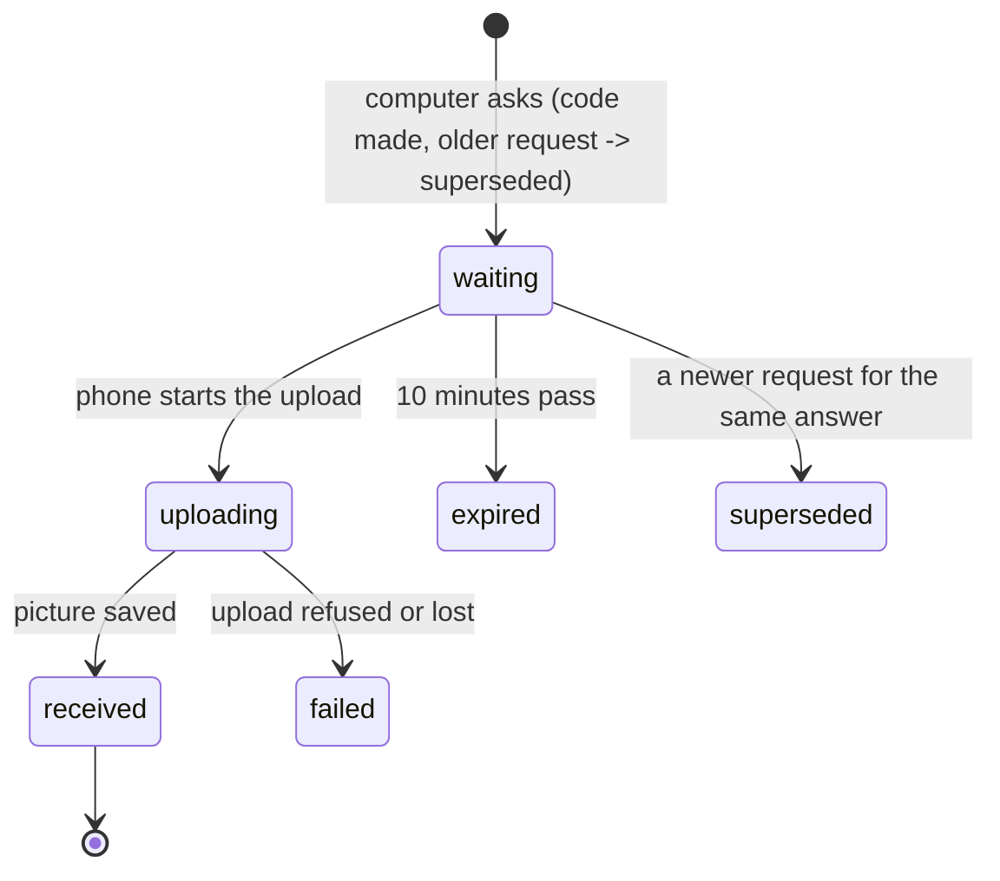

# Design

## Context

See proposal.md for why. After stage 5, `mathly2/` has what a written hand-in builds on, and none of the written-work machinery:

- **Reusable:** the smart board (`MathlyBoard.mount(layer, key, {submit, sendLabel, pages})`, copied unchanged from mathly1: `submit(page, picture)` receives the page as a picture and resolves to `{error}` or `{}`); classes with teachers and students (`m2_classes`, `store.members`, `classes_taught`); the grades screen and `/api/grades`; the student's home; the bank's four authored written quizzes (`unit.quiz`: minutes, four questions with `points` and `skills`); `exercise_test` attempts of a real test (stage 5).
- **Missing:** any file storage, image handling, assignments, submissions, phone requests and push. mathly1 has all of it (`app/answer_scans.py`, `app/worksheets.py`, `app/push.py`, `static/answer-scans.js`, `static/service-worker.js`) on Supabase RPC functions and a Hugging Face bucket; mathly2 re-implements it on its own `m2_` tables and keeps its own pictures (PRD: mathly1's tables and buckets stay untouched, so the Space can fall back).
- **Dependencies:** the build adds `Pillow` (image checks), `pypdfium2` (teacher PDFs to page images) and `pywebpush`, the same libraries mathly1 uses. mathly1's requirements are the reference for versions.

## Goals / Non-Goals

**Goals:**
- A student hands in pictures from the board, a phone camera, an uploaded file, or their phone on a computer's request; a teacher checks them from one inbox.
- Pictures are private (readable only through the server), cleaned of metadata, and removed on time.
- A computer can ask the student's phone for a photo, with a code and a push notification.

**Non-Goals:**
- AI checking, the AI queue and photo help (stage 7). The inbox holds typed items so "request to look again" can join later.
- The class heat map and coverage (stage 8).
- Grading scores per question: a grade is one number 0–100 for the whole submission.

## Decisions

### 1. Five tables, pictures as rows

| Table | Columns |
|---|---|
| `m2_pictures` | `id` uuid, `owner_id` uuid (the uploader), `kind` (`page` for an assignment page, `answer` for a student's picture), `path` (the object name in the bucket), `content_type`, `size`, `created_at`, `deleted_at` null |
| `m2_assignments` | `id` bigint, `class_id` → `m2_classes`, `title`, `note`, `due_date`, `kind` (`pages`, `quiz`, `exercise_test`), `pages` uuid[] (the pictures of a `pages` assignment), `quiz_lesson` text (the lesson whose written quiz it is), `test_id` + `exercise_number` (an exercise test), `created_by`, `created_at`, `removed_at` null |
| `m2_submissions` | `id` bigint, `assignment_id`, `user_id`, `pictures` uuid[], `state` (`handed_in`, `graded`, `returned`), `handed_at`, `grade` 0–100 null, `teacher_note`, `checked_at`, `checked_by`, unique (`assignment_id`, `user_id`) |
| `m2_photo_requests` | `id` uuid, `user_id`, `assignment_id`, `device` text (the computer that asked), `code` (4 digits), `state` (`waiting`, `uploading`, `received`, `failed`, `expired`, `superseded`), `created_at`, `expires_at`, `picture_id` null |
| `m2_push_subscriptions` | `id` bigint, `user_id`, `endpoint` unique, `p256dh`, `auth`, `key_id` (a fingerprint of the server's push key), `created_at` |

A written quiz is not copied into the assignment: the row names the lesson and the questions and points are read from the bank, so the assignment always shows what the bank says. A student has one submission per assignment; a resubmission after "returned" rewrites that row (state back to `handed_in`, new pictures). Row security as the other `m2_` tables (server key only). The migration is `20261112090000_m2_written_work.sql`. *Alternative:* a version history of submissions. Rejected: the spec only needs "see the note and hand in again", and mathly1's history is not in the PRD.

### 2. Pictures: the server is the only door

`pictures.py` holds the logic and two stores of bytes behind one small interface (`put`, `get`, `delete`): `MemoryPictures` for tests and local development, and `SupabasePictures`, a **private** Storage bucket named by the setting `MATHLY_M2_ANSWER_BUCKET` (default `m2-answers`; not `MATHLY_ANSWER_BUCKET`, which mathly1 reads from the shared `.env` for its own Hugging Face bucket, nor its `mathly-answers`), read and written only with the secret key. The server creates the bucket on first use if it is missing (the Storage API, idempotent), so the migration needs no `storage` schema. *Alternative:* mathly1's Hugging Face bucket, chosen there to avoid Supabase egress. Rejected for now: a second token and library, and egress is not a problem at this size; the interface keeps it a later swap.

- **`clean_image(bytes, content_type)`** (ported): only JPEG, PNG or WebP up to 5 MB and 20 million pixels; the orientation is applied, the metadata dropped, the image re-encoded as JPEG. Anything else is refused (415 or 413).
- **`render_pdf(bytes)`** (ported, teacher assignments only): up to 10 MB, 1600 px wide, 30 seconds for all pages, at most 20 pages; each page becomes a `page` picture, and the PDF itself is not kept.
- **Access:** `GET /api/pictures/{id}` streams the bytes, never a link into storage. Readable by: the uploader; a student of the class for a page of their class's assignment; the teacher of the class (or a developer) for a picture an assignment or a submission of their class refers to. A manager or an admin sees no learning data, so no pictures. Anything else is 404. A deleted picture is 410.

### 3. Handing in

`POST /api/pictures` (kind `answer`, raw image bytes, student) returns an id; nothing refers to it yet. `POST /api/assignments/{id}/submission` with `{pictures: [ids]}` (1–10 pictures that the student uploaded) creates or replaces the submission: allowed while there is none, while it is `handed_in` (replace) or `returned` (hand in again), refused with 409 once `graded`. A hand-in after the due date is accepted and marked `late` (the due date is shown, never a lock). The board hands in a page by uploading it as an `answer` picture and adding its id to the draft the screen keeps; the phone camera and a file chooser do the same; the computer's photo request (decision 4) delivers a picture the same way. The draft lives in the page (and its ids in `sessionStorage`) until "הגשה".

### 4. The photo request: the server holds the state, the screens poll

`POST /api/photo-requests` `{assignment_id, device}` makes the request, a random 4-digit `code`, an `expires_at` 10 minutes ahead, and supersedes the student's earlier waiting request for the same assignment. The computer polls `GET /api/photo-requests/{id}` every 2 seconds and draws the state and the code. The student's phone polls `GET /api/photo-requests/open` every 5 seconds while the app is open and at once when the service worker says a notification was tapped; any open request **not made by this device** (`device` differs) is shown in a window with the same code and a camera button. The phone's upload is `POST /api/photo-requests/{id}/picture` (raw bytes): the server sets `uploading`, cleans and stores the picture, then `received` with its id, or `failed`. Expiry is computed when a request is read (like attempts), so nothing runs in the background. A request is only ever read by its owner.

### 5. Push notifications

`push.py` (ported from mathly1) holds the sender behind an interface so tests use a recording fake. The key is the setting `VAPID_PRIVATE_KEY` (and `VAPID_SUBJECT`, default `mailto:` the first developer); without it push is off, `GET /api/push/key` says so and the screens do not offer notifications, while a phone that has the app open still sees requests by polling. A phone subscribes with `POST /api/push/subscribe` (only phones show the button: touch devices); each subscription stores a `key_id`, a fingerprint of the public key, and every read or send first deletes subscriptions with another `key_id` (changing the key drops them all). A push service answering 404 or 410 deletes that subscription. The push is sent when a request is created, to the student's subscriptions only (the computer never subscribes), carrying the request's address. The service worker (`/service-worker.js`, served from the root so it covers the app) is mathly1's: it shows the notification and, on a tap, focuses the app and posts it a message, or opens the address. `manifest.webmanifest` is copied from mathly1 and linked, because an iPhone delivers notifications only to the app added to the home screen (iOS 16.4+).

### 6. Teachers: giving work and checking it

- **Giving:** `POST /api/classes/{id}/assignments`, for a class the teacher teaches (a developer: any). The body names the title, note, due date and one source. *File:* images or a PDF uploaded first as `page` pictures (PDF pages rendered), listed in `pages`. *Photo:* the same upload from the camera. *Board:* the board's hand-in uploads each page as a `page` picture. *Bank:* `quiz_lesson`, accepted only for a lesson of the class that has an authored written quiz; the screen shows its questions with points. *Exercise test:* `test_id` and `exercise_number` of a test of that class (the PRD's EXT-2). Removing an assignment hides it (`removed_at`); grades already given stay on the student's grades screen.
- **Seeing:** `GET /api/teaching/assignments` lists a teacher's assignments with how many students handed in, graded and not.
- **The inbox:** `GET /api/teaching/inbox` lists submissions in state `handed_in`, oldest `handed_at` first, each with the student, the assignment, the picture ids, and a `kind: "submission"` field (stage 7 adds `recheck`). A `returned` submission waits for the student and is not listed.
- **Checking:** `POST /api/submissions/{id}/grade` `{grade 0–100, note, seen}` and `POST /api/submissions/{id}/return` `{note, seen}` (the note is required for a return; `seen` is the `handed_at` the teacher was looking at, and a different one gives 409). Only the class's teacher (or a developer) may; a picture of a submission is read through the picture route above. Grades are whole numbers, the same scale as every other grade.
- **Exercise-test assignments** have no submission: the student's state comes from their attempts at that exercise test (done when one is submitted, grade = the best), and nothing reaches the inbox.

### 7. Students: my assignments and the grades

`GET /api/assignments` lists the student's assignments (of their classes, not removed): title, class, due date, state (`not_handed`, `handed_in`, `graded`, `returned`, or for an exercise test `not_done` / `done`), `late`, grade, note. `GET /api/assignments/{id}` adds the pages (picture ids), the bank questions for a written quiz, the student's pictures, and the teacher's note. Home shows "המשימות שלי" with the open ones first (nearest due date), then done ones; `/api/grades` adds `assignments` (graded submissions and done exercise-test assignments) so the grades screen and the readiness inputs of stage 5 stay in one place.

### 8. Keeping pictures: orphans, the school year, and on request

- **Orphans:** a picture no assignment, submission or photo request refers to and older than 24 hours is deleted by the cleanup.
- **The school year:** `retention.expires_on(day)` is 31 August of the school year the picture was created in (1 Sep to 31 Aug); `answer` pictures are deleted on the first cleanup after it. Deleting removes the bytes and sets `deleted_at`; the submission keeps its grade and note, and the screens say "התמונות נמחקו". Assignment pages stay until their assignment is removed.
- **On request:** `DELETE /api/classes/{id}/pictures/{email}` (not under `/students/`, whose `{email}` route would swallow it) by the class's teacher, a manager or a developer deletes that student's `answer` pictures for that class's assignments at once.
- **The job:** `cleanup.run(store, pictures, now)` returns what it removed, `python -m mathly2.cleanup` runs it once, and the server starts it every hour in the background when Supabase is on (the real deployment).

## Risks / Trade-offs

- [The board's hand-in, pen and camera cannot be fully tested headless] → The tests draw a stroke and press the board's send button, upload files, and use a stand-in for the camera input; the real camera and pen are a manual check on a phone and a tablet.
- [Polling every 2–5 seconds for a request costs requests] → Only while a request is open (10 minutes at most) and only on the two screens that show it; push makes the phone's first look immediate.
- [A student uploads someone's face or personal details] → Pictures are private, metadata stripped, deleted at the end of the school year, and the teacher can delete a student's pictures on request (PRD privacy).
- [The server creates the bucket on first use] → It needs the secret key's Storage permission; if the call is refused the screens show "האחסון לא זמין" (database-problems wording) and nothing else breaks.
- [An old submission's pictures are deleted while it is graded] → By design: the grade and note stay; only the pictures go.
- [A teacher grades a submission the student just replaced] → Grading reads the current row; a replace after the page was opened is refused with 409 ("ההגשה השתנתה"), by comparing `seen` with `handed_at`.

## Migration Plan

Run `20261112090000_m2_written_work.sql` after the seven earlier migrations; it only adds five tables. Set `VAPID_PRIVATE_KEY` (and `VAPID_SUBJECT`) to turn push on: without them everything else works. Make a key with `python -m mathly2.push` (printed once; keep it as a secret). Rollback: `drop table m2_push_subscriptions, m2_photo_requests, m2_submissions, m2_assignments, m2_pictures` (in the file header); the bucket `m2-answers` is left as it is.
