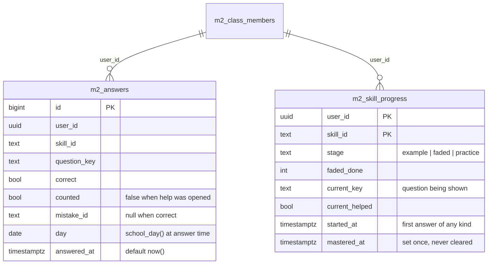
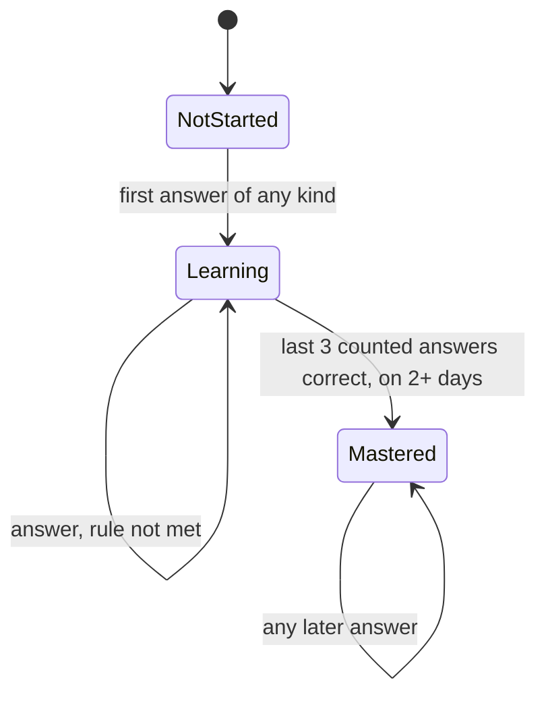
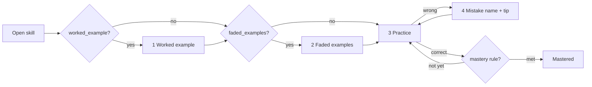
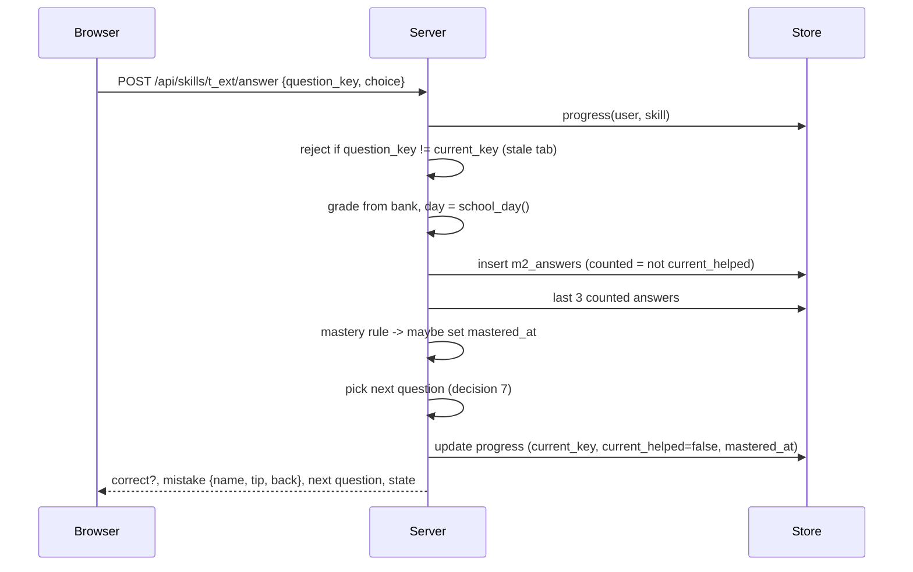

# Design

UI sketch: [static mockup](./mockups/skill-learning.html). It predates decision 4: its faded-example screen shows typed boxes, while the design uses multiple-choice steps.

## Context

See proposal.md for why. Current state in `mathly2/` after `build-foundation`:

- `bank.py` loads and checks `content/math_algebra9.json`. `GET /api/lessons` serves lessons and skills without questions.
- `store.py` has `InMemoryStore` (tests, local development) and `SupabaseStore` (PostgREST, secret key) with the same methods. Tables are `m2_*`, row-level security on, no browser grants.
- `clock.school_day()` gives the calendar day in Asia/Jerusalem. It was built for the mastery rule.
- `static/student.js` only lists lessons. Screens are plain ES modules that render HTML strings into `#app`.

Facts about the bank that shape this design:

| Fact | Consequence |
|---|---|
| 96 skills, 1,050 questions, median 10 per skill. `a_30_side` has none. | Enough for "a different question". One skill cannot be practised yet. |
| Questions have no id. Within a skill, no two are fully identical (10 share the same text but differ in figure or choices). | A key must be derived (decision 3). |
| 410 questions have a `figure` (geometry text such as `A=0,2; ... poly A B C D`) and 53 have a `graph` (points and axis ranges), across 48 skills. | Practice must draw them (decision 9). |
| Every wrong choice has a `mistake`. Only 40 of 244 mistakes have a `back` skill. | Feedback can always name the mistake. A "go back to" link is shown only when `back` exists. |
| No skill has `worked_example` or `faded_examples`. `scripts/content_gaps.py` already looks for those two field names. | The new content uses those names (decision 4). Stages without content are skipped (spec). |

## Goals / Non-Goals

**Goals:**
- Every rule that counts for mastery is decided on the server from rows it wrote itself: correctness, the date, whether help was opened.
- The whole path works today with the bank as it is. Examples are added skill by skill without code changes.
- One code path for both stores, so every rule is tested on `InMemoryStore` and runs the same on Supabase.

**Non-Goals:**
- Writing the 96 skills' examples. This change defines their shape, checks them, and ports the drafting tool. Teachers write and approve the content.
- Anti-cheating beyond the server owning the rules. A student can still look answers up elsewhere.
- Quizzes, exercise tests and teacher views. They read the skill states this change produces (later changes).

## Decisions

### 1. Two new tables: an answer log and a per-skill progress row



A view `m2_daily_correct (user_id, day, correct)` counts correct practice answers per day for the goal and streak.

- `m2_answers` is append-only. It is the evidence for mastery and later for weak skills, quizzes and the heat map.
- `m2_skill_progress` holds what the server must remember between requests: the stage, the question on screen, whether help was opened for it, and `mastered_at`.
- *Alternative:* derive everything from the log on every read. Rejected: the path screen would scan every answer for 96 skills, and "question on screen + help opened" is not an answer at all.

### 2. Mastery is stored once, when the rule is first met

After each counted practice answer the server reads the student's last 3 counted answers on that skill. If all 3 are correct and they fall on 2 or more distinct `day` values, it sets `mastered_at` if it is still null. Nothing ever clears it.



- State is derived from the progress row: no row or no `started_at` means not started; `mastered_at` set means mastered; anything else means learning.
- "First answer of any kind" includes "why this step?" and faded steps, so a student working through the example sees "learning". Only practice answers count for mastery.
- "Counted" means no help was opened for that question. Uncounted answers are skipped: they neither extend nor break the run (spec: Help between correct answers).
- *Alternative:* recompute mastery on every read. Rejected: mastery must never decay, and a stored timestamp also gives the collection screen and the later period views "mastered as of a date" for free.

### 3. Question key = skill id + hash of the question

`question_key = f"{skill_id}:{sha1(canonical JSON of the question)[:10]}"`.

- Stable when questions are reordered or added. Editing a question gives it a new key, which is right: it is a different question.
- `check_bank` rejects two questions with the same key in one skill.
- *Alternative:* skill id + index. Rejected: inserting a question would silently re-key every answer after it.

### 4. Shape of worked and faded examples, with multiple-choice steps

```json
"worked_example": {
  "question": "$x^2 + 5x + 6$",
  "steps": [
    {"do": "two numbers: product 6, sum 5 -> 2 and 3",
     "why": [{"text": "...", "correct": true}, {"text": "..."}, {"text": "..."}]}
  ],
  "answer": "$(x+2)(x+3)$"
},
"faded_examples": [
  {"question": "...",
   "steps": [{"do": "...", "choices": [{"text": "...", "correct": true}, {"text": "...", "mistake": "sign_mid"}]}],
   "answer": "..."}
]
```

- A missing faded step is filled in by choosing among options. A wrong option names its mistake, reusing the bank's `mistakes`. *Alternative:* typed math. Rejected for now: it needs a math answer checker, and the spec only requires that the student fill the step and get feedback.
- Each skill has **2 faded examples**: the first hides its last step, the second its last 2 steps. Fading goes backwards, so the student first finishes a solution and then starts one. Backward fading is the variant with the stronger research support. A faded example therefore needs at least 2 steps, and the second needs one step more than it hides, so the student never faces an empty solution.
- `check_bank` checks the shape when present: exactly 2 faded examples, the first with at least 2 steps and the second with at least 3, exactly one correct `why` and one correct choice per step, mistake ids exist.

### 5. Teaching stages are checked in the browser; practice on the server



- Worked and faded examples are sent whole, including which choice is right, and checked in the browser for instant feedback. They are teaching material and do not count for mastery. The browser reports progress (`stage done`, `faded k done`) so the server can resume and mark the skill as started.
- Practice questions are sent **without** `correct` or `mistake`. Choices carry their original index, and the browser may shuffle them for display. The server grades by index.

### 6. Practice API and one answer, end to end

| Endpoint | Purpose |
|---|---|
| `GET /api/path` | All lessons and skills with state, today's correct count and the streak |
| `GET /api/skills/{id}` | Stage, worked and faded examples (if any), and the current practice question |
| `POST /api/skills/{id}/stage` | Browser reports a finished stage or faded example |
| `POST /api/skills/{id}/help` | Marks the question on screen as helped |
| `POST /api/skills/{id}/answer` | `{question_key, choice}` -> result, feedback, next question, new state |
| `GET /api/collection` | Mastered skills and completed lessons |



- The answer must match `current_key`, so a second tab or a replayed request cannot answer a question that is not on screen.
- On a wrong answer the response has the mistake's name and tip and never the correct choice.

### 7. Next question: least seen, never the one just answered

Pick at random among the skill's questions with the fewest past answers by this student, excluding the question just answered. With about 10 questions per skill, a student meets every question before any repeats. A skill with one question repeats it, and a skill with none shows "no practice yet" and cannot be mastered.

### 8. Daily goal and streak from the view

Today's goal = correct practice answers on `school_day()`. The streak = consecutive days with at least 5, ending today, or ending yesterday when today is not yet at 5, so the streak is not shown as lost in the morning. Helped answers count toward the goal: it measures effort, not mastery.

### 9. Draw figures and graphs by porting the old renderer

Copy the `figure` (geometry) and `plot` (graph) drawing functions from the old `static/math.js` into `mathly2/static/figures.js`, with a Playwright check that one of each draws. This follows the precedent of `math-tex.js` in build-foundation: it is part of showing the exercise bank, not the old app's behaviour. *Alternative:* skip figure questions. Rejected: that removes most practice from 48 skills.

### 10. Drafting tool ported, not run

`scripts/draft_examples.py` moves to `mathly2/scripts/` and is changed to produce the decision 4 shape (multiple-choice `why`, faded examples with choices). Its review-file flow (draft -> teacher approves -> merge) stays. Running it spends API money and needs a teacher, so it is a tool in this change, not a task.

## Risks / Trade-offs

- [Teaching-stage answers are checked in the browser, so a student can see the right "why" choice in the network tab] -> Accepted: they do not count for anything, and instant feedback matters more there.
- [Help is reported by the browser through `/help`. A modified client could skip the call and get a "counted" answer] -> Accepted for now: the student would also need 3 correct on 2 days. The same holds for any client-side app, and the alternative (serving help only from the server) is what `/help` already does for the honest client.
- [Editing a question gives it a new key, so its old answers stop matching it] -> Intended. Mastery and the log are by skill, so nothing is lost.
- [Students mastering one skill with 0 or 1 question] -> `a_30_side` cannot be mastered until it gets questions. `content_gaps.py` already lists it.
- [The ported figure renderer drags old-app code in] -> Copy only the two drawing functions and what they need, with their own tests.

## Migration Plan

- One additive migration: `m2_answers`, `m2_skill_progress`, the `m2_daily_correct` view. Row-level security on, no browser grants, as in `m2_classes`. Rollback: drop the three objects. Nothing else reads them yet.
- The bank file gains optional fields only, so the current bank still loads.
